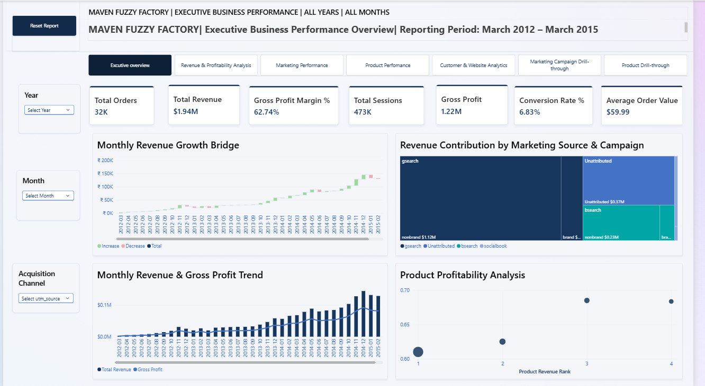
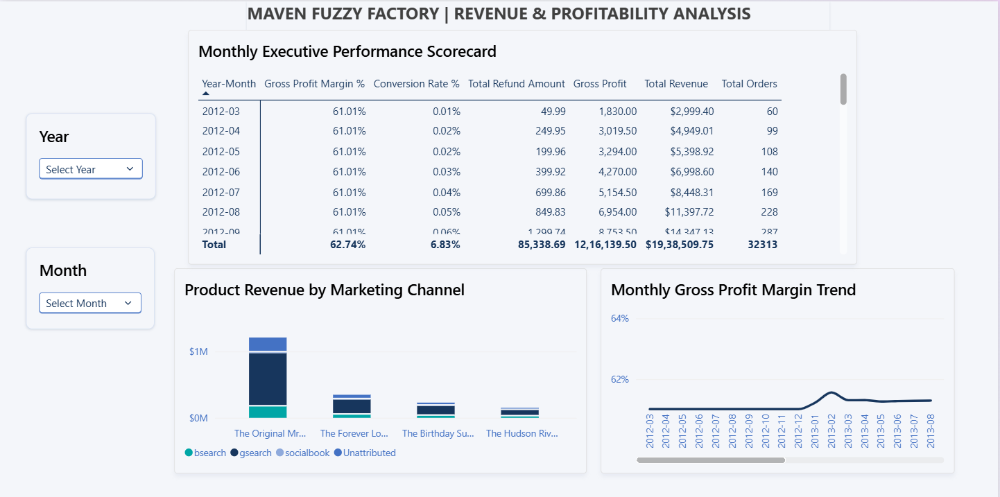
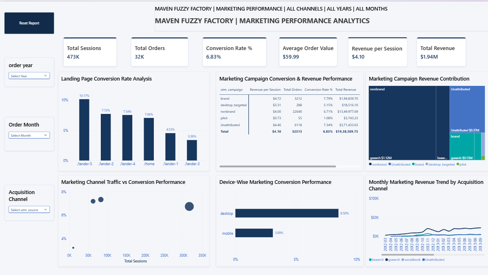

# Maven-Fuzzy-Factory-End-to-End-Data-Analytics
End-to-end e-commerce data analytics project using SQL Server, Python, and Power BI to analyze sales performance, customer behavior, marketing effectiveness, and business growth. 

📌 Project Overview

Maven Fuzzy Factory is an e-commerce data analytics project focused on analyzing sales performance, customer behavior, website conversion, product performance, and marketing effectiveness.

This project follows a real-world end-to-end data analytics workflow, transforming raw data into actionable insights using SQL Server, Python, and Power BI.

 🎯 Business Problem

The business needs to understand how website traffic converts into revenue, which marketing channels generate the best performance, how customers purchase products, and where opportunities exist to improve profitability, customer retention, and overall business growth.

The objective is to identify performance gaps, uncover growth opportunities, and support data-driven business decisions through analytics.

## 🛠️ Tools & Technologies

- **SQL Server** – Data extraction, querying, KPI calculations, business analysis, and advanced SQL techniques.
- **Python** – Data analysis, exploratory data analysis (EDA), data manipulation, and visualization.
- **Power BI** – Interactive dashboards, data modeling, DAX measures, KPI tracking, and business reporting.
- **Excel** – Data inspection, validation, and preliminary analysis.
- **GitHub** – Version control, project documentation, and portfolio presentation.

  ## 🔄 Project Workflow

1. **Problem Statement** – Define business objectives and analytical questions.
2. **Data Collection** – Collect and understand the raw datasets.
3. **Data Cleaning** – Handle missing values, duplicates, data inconsistencies, and validate data.
4. **SQL Analysis** – Perform business analysis using joins, CTEs, window functions, aggregations, and KPI calculations.
5. **Python Analysis** – Conduct exploratory data analysis, trend analysis, and data visualization.
6. **Power BI Dashboard** – Develop interactive dashboards with KPI cards, DAX measures, slicers, drill-through, bookmarks, and time intelligence.
7. **Business Insights** – Identify patterns, trends, performance gaps, and growth opportunities.
8. **Recommendations** – Translate findings into actionable business strategies.

## 📊 Power BI Dashboards

### 1. Executive Overview
Provides a high-level overview of business performance through revenue, orders, customers, and key performance indicators.

### 2. Revenue & Profitability Analysis
Analyzes revenue, costs, gross profit, gross margin, and profitability trends.

### 3. Marketing Performance
Evaluates marketing channels, campaign performance, traffic, conversion rates, and revenue contribution.

### 4. Product Performance
Analyzes product sales, revenue contribution, product trends, and purchasing behavior.

### 5. Customer & Website Analytics
Evaluates customer behavior, website sessions, conversion performance, and repeat purchasing patterns.

## 📈 Key Business KPIs

| KPI | Value |
|---|---:|
| Total Revenue | $1,938,509.75 |
| Gross Profit | $1,216,139.50 |
| Gross Margin | 62.74% |
| Total Orders | 32,313 |
| Total Customers | 31,696 |
| Website Sessions | 472,871 |
| Conversion Rate | 6.83% |
| Average Order Value (AOV) | $59.99 |
| Refund Amount | $85,338.69 |
| Refund Rate | 4.32% |
| Repeat Purchase Rate | 1.86% |

## 💡 Key Business Insights

- Generated approximately **$1.94M in revenue** from **32,313 orders**.
- Achieved a **62.74% gross margin**, generating approximately **$1.22M in gross profit**.
- Acquired **31,696 customers**, of whom **31,105 were one-time customers**.
- Identified a **1.86% repeat purchase rate**, highlighting an opportunity to improve customer retention.
- Generated **472,871 website sessions** with a **6.83% conversion rate**.
- Recorded **$85,338.69 in refunds**, with a **4.32% refund rate**.
- Identified opportunities to improve repeat purchases, marketing efficiency, website conversion, and product profitability.

## 🚀 Business Recommendations

- Implement targeted email marketing and remarketing campaigns to increase repeat purchases.
- Develop cross-selling, upselling, and product bundling strategies to improve Average Order Value.
- Optimize marketing campaigns based on conversion rate, revenue contribution, and traffic quality.
- Improve website user experience and checkout flow to increase conversion.
- Investigate products with high refund rates and address product quality or customer expectation issues.
- Monitor customer retention, revenue, profitability, and marketing KPIs through Power BI dashboards.

## 📁 Repository Structure

``text
Maven-Fuzzy-Factory-End-to-End-Data-Analytics/
│
├── 01_Problem_Statement/
├── 02_Data_Collection/
├── 03_Data_Cleaning/
├── 04_SQL_Analysis/
├── 05_Python_Analysis/
├── 06_PowerBI_Dashboard/
├── 07_Business_Insights/
├── 08_Recommendations/
└── README.md

## 🧠 Skills Demonstrated

- SQL Querying & Advanced SQL Analytics
- Data Cleaning & Data Validation
- Exploratory Data Analysis (EDA)
- Python Data Analysis
- KPI Development & Business Metrics
- Data Modeling & Relationships
- DAX & Time Intelligence
- Interactive Dashboard Development
- Data Visualization & Storytelling
- Business Insights & Strategic Recommendations

## 🎯 Project Objective

The objective of this project is to simulate a real-world data analyst workflow by extracting, cleaning, analyzing, and visualizing e-commerce data to uncover business insights, identify performance gaps, and provide data-driven recommendations that support business growth, profitability, marketing optimization, and customer retention.

## 📸 Dashboard Previews

